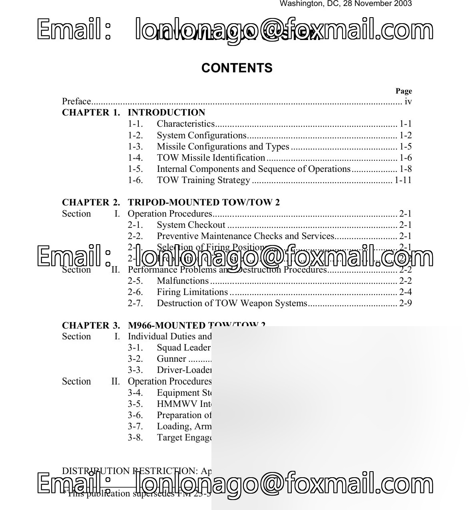
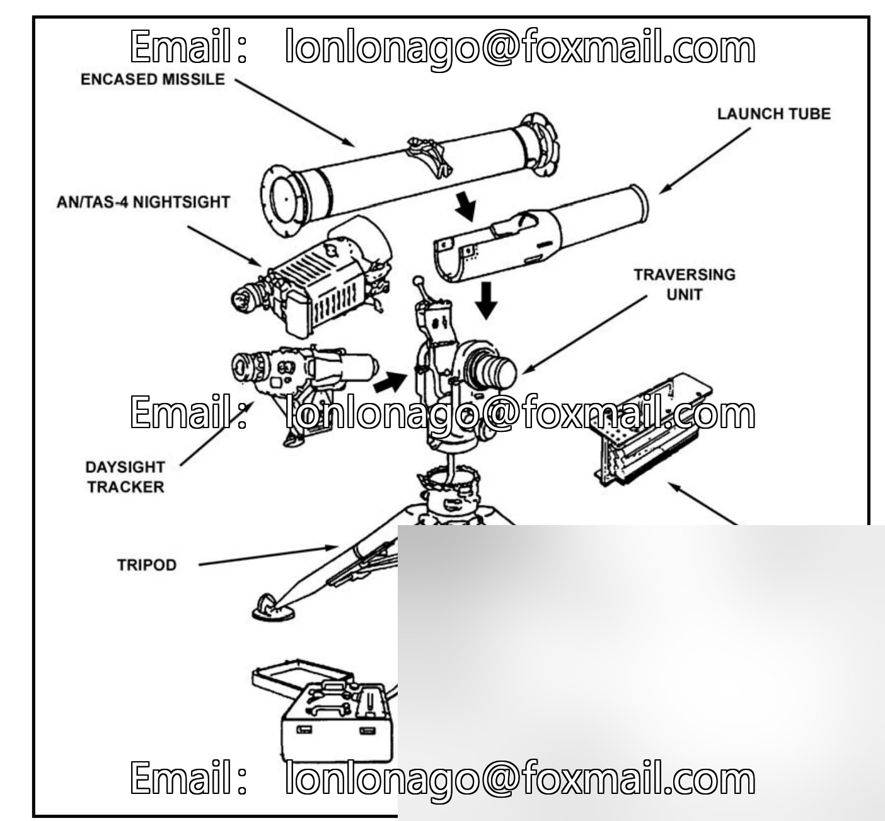
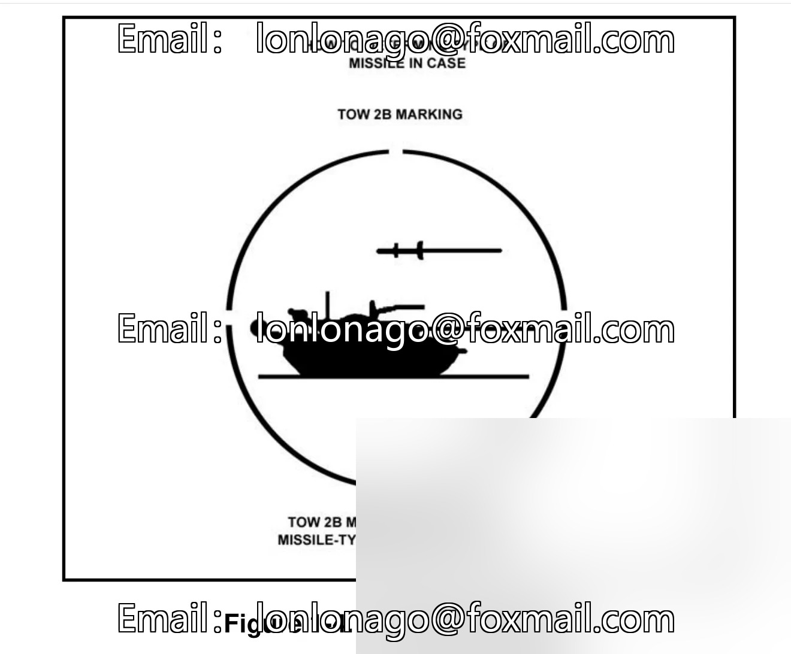
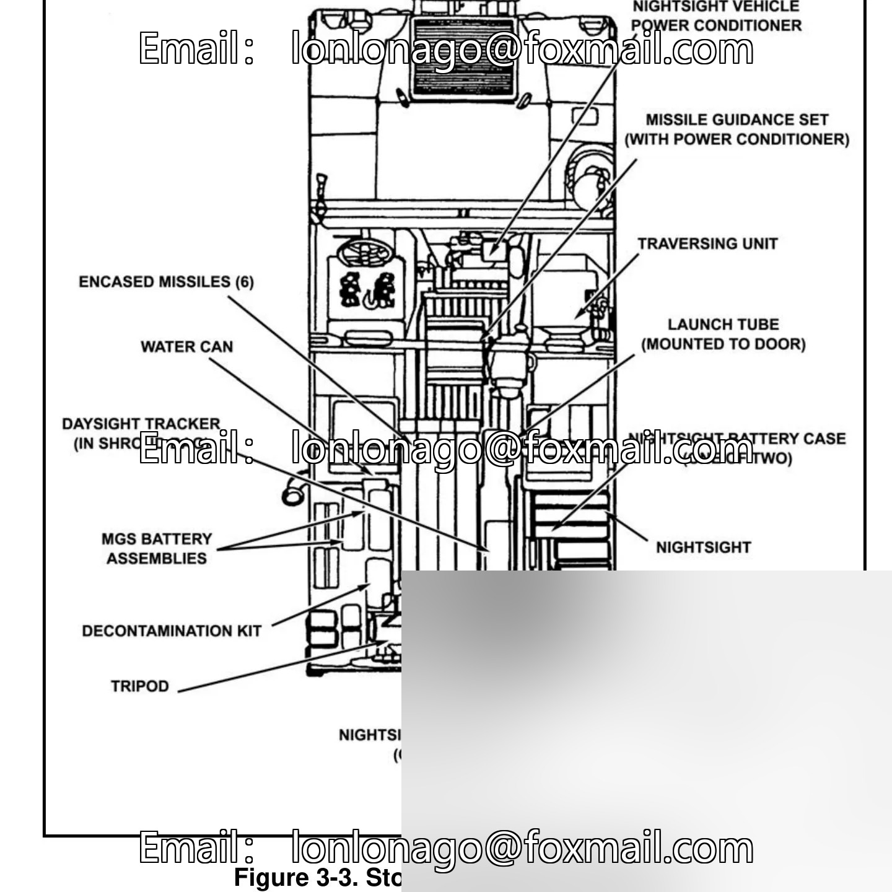
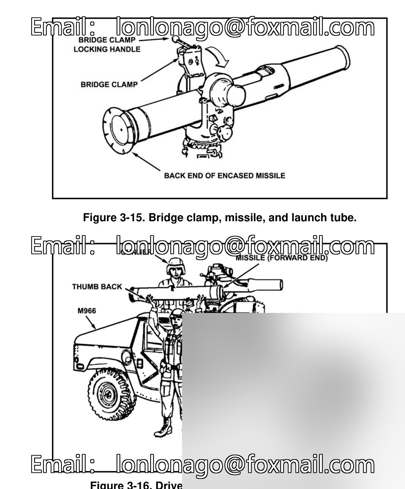
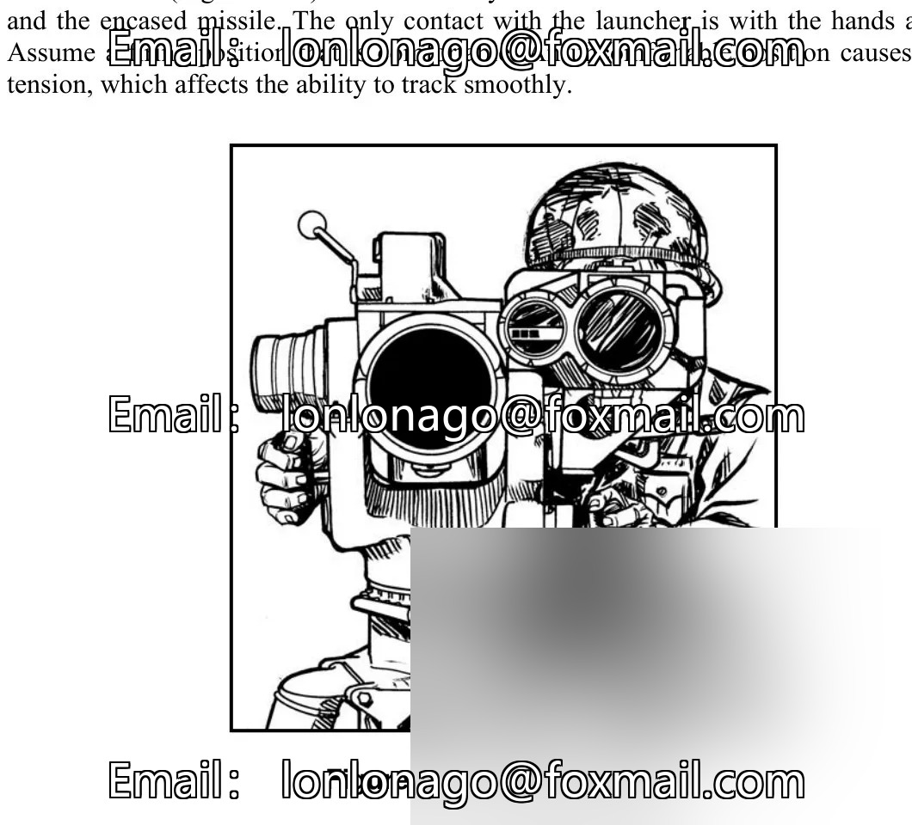

# “TOW Weapon System” (TOW Weapon System)

## Body

“TOW Weapon System” cover of the U.S. Army Field Manual.

Its core content is an official operational and training guide for tube-launched, optically-tracked, wire-guided missiles.

This resource features the cover of the U.S. Army Field Manual for the TOW Weapon System, along with official operation and training guidance for tube-launched, optically-tracked, wire-guided missiles.

<!-- AI_ENRICHED -->

## Images

## Payment

Here is a pay link on Stripe ( https://buy.stripe.com/3cs8yP7sY87d0vu9AB ). Please contact me lonlonago@foxmail.com after funding $89, and I will send you a complete data files , thank you!

